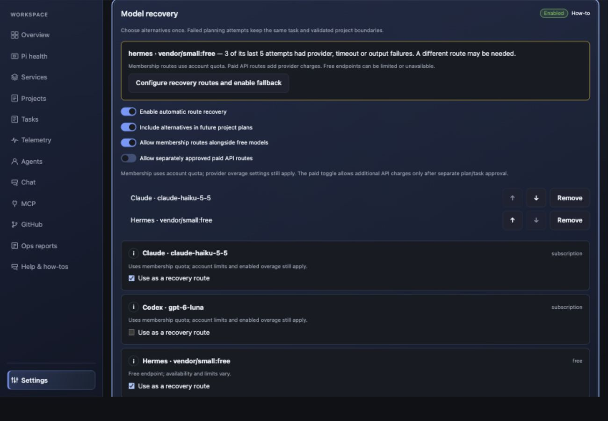
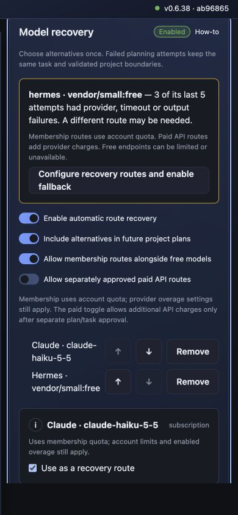

# Shared-feature parity audit — 0.6.38

Audit date: 2026-10-20. Baselines: MCD 0.6.37 (`3086c14`) and RCD 0.6.37 (`ab96865`). The full inventory covers API Python, web source, role/standards packs and configuration documentation. The initial scan found 483 common files: 337 identical, 22 different only in branding, and 124 with other differences. Product-specific files include hardware/service implementations, migrations, updater integration and RCD durable adapters.

## Findings and changes

| Shared area | Finding | Result in this release |
| --- | --- | --- |
| Project schemas | Shared node/document/approval schemas match semantically; class ordering differs. | Named schema comparison guards that contract. |
| Planning retries | Both apps could exhaust approved routes and stop; project restart could generate more planning cards. | Same-step retry, bounded validation repair, canonical route identity and configured alternatives share one implementation. |
| Failed story controls | MCD mounted TaskRetryAction; RCD exposed backend retry actions without the equivalent task component. | Both task details offer the same free, membership and paid controls, with timeout review. |
| Bootstrap | Draft generation depended on successful model-produced plans before any setup work could start. | Shared app-owned editable setup template, idempotent reopening and validated dependency dispatch. |
| Membership routing | MCD defaults Claude/Codex billing to membership; RCD requires operator configuration and defaults to free-only dispatch. | Defaults are preserved and visible. RCD users can configure memberships and deliberately permit them alongside free routes. Paid API remains a separate explicit toggle and per-plan/task approval decision. |
| Route telemetry | Process exit success did not distinguish unusable planning output. | Contract failure events, bounded local route statistics, repeated-failure advice, cost notices and direct toggle links. |
| Risk and acceptance | Recovery must preserve approved bounds and risk floors. | New automatic story alternatives are shown on the editable map, checked against risk rules, then authorized at plan approval. Timeouts and incomplete results still need review. |
| Appearance and navigation | Shared status cards/toggles exist; model failures lacked a direct configuration destination. | Shared recovery panel/notice uses ManagedItem, PanelHead, ToggleSwitch and NoteFold. Failure notices deep-link to the exact settings panel; billing links open the billing dialog. |
| Media, Chat, roles and settings | Shared modules coexist with platform-specific host/runtime code. | Existing feature routes are retained; Chat uses the same explicit membership admission option. No installer, identity or live native configuration is changed by the audit. |

## Cleanup and accounting

Both products retain usage-only accounting before cascading task/chat/project deletion, preserve unknown-cost evidence, and deduplicate late native telemetry. The overview shows configured agents rather than listing historical sessions as current agents. Native runtime session history and working folders are intentionally preserved and described in deletion confirmations. Free-router aliases no longer create a false unpriced warning.

## Repeatable contract check

From either checkout, using Python 3.12 for development-source parsing:

```sh
python scripts/check-shared-features.py --peer /path/to/other-dashboard
```

The check compares 37 shared files, function/schema definitions and mounted controls. Its inventory separately lists all source differences instead of treating every difference as a defect. See [the machine-readable inventory](parity-inventory-0.6.38.json). The shared contract check passed with zero mismatches.

This is not a claim that the native runners are identical. RCD retains its durable adapter supervision and additional typed context/dependency evidence checks; MCD retains its native Mac runner and source-upgrade integration. Launchd/systemd, hardware collectors, migration history and updater packaging require platform-specific checks. Live provider availability, sign-in validity, native fallback conformance and physical-Pi behavior are not certified by matching source or synthetic fixtures.

## Isolated UI receipt

Synthetic recovery previews were inspected at desktop (1300 × 900) and mobile (390 × 844). RCD mobile document width and scroll width were both 390 pixels. The preview has no collectors, dispatcher, provider calls, real credential reads or enabled write routes.

- URL: `http://127.0.0.1:8838/profile#route-recovery` for MCD; port 8839 for RCD.
- Source: the 0.6.38 candidate, based on the baseline commits above; screenshots show synthetic data.
- Start: `python scripts/preview-release-features.py --port PORT --data-dir /tmp/PRODUCT-route-reliability/synthetic-release-preview` from that product checkout after building its web UI.
- Stop: Ctrl-C in that preview process’s terminal. Never stop another service by executable name.
- Data: the named private synthetic directory only; no production database is used. All mutation endpoints are refused.





## Recovery limits

Providers and models can still fail. The application guarantees bounded attempts and keeps the project/task available for explicit recovery; it cannot guarantee a provider response or correct reasoning. Native runtime and provider fallback/overage settings can affect billing and must be reviewed in addition to app route choices. Bootstrap files outside an approved workspace require scoped tools/permission or a linked manual apply step. Existing user configurations are never overwritten by the built-in template.
